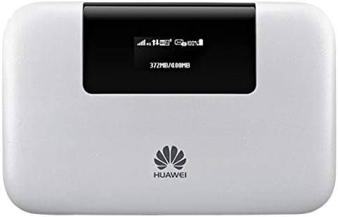
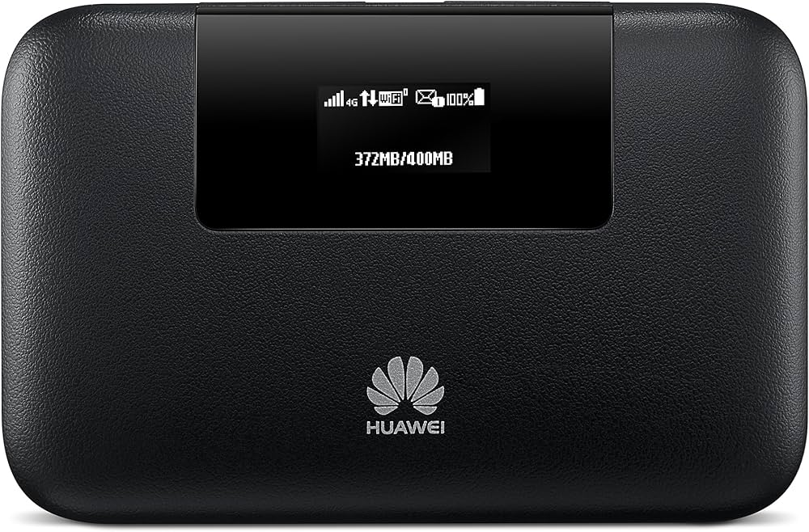
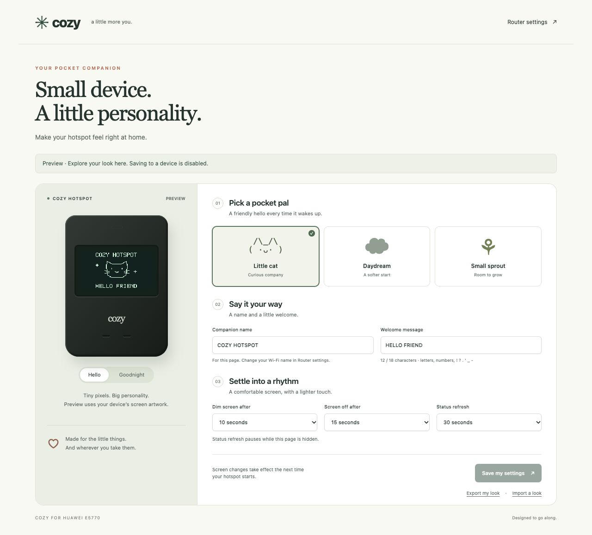

# Cozy for Huawei E5770

A personal firmware fork with friendly pixel screens, a customization menu, and
security and stability repairs to the E5770 mod.

**Complete experimental firmware and WebUI images are included.** Offline checks
cover format, all partition CRCs, source contents and reproducible builds. No
device has been flashed or hardware-qualified; full security auditing remains
open. Read [INSTALL.md](docs/INSTALL.md) before a device write and
[the audit](docs/AUDIT.md) for the evidence and remaining work.

| White hardware reference | Black hardware reference |
| --- | --- |
|  |  |

User-supplied appearance photos. Confirm the actual variant from its label/API.

Based on upstream commit `a4b7711f7564bfd408ce925564b128e05c20313d`, firmware
`21.329.01.00.00`, WebUI `17.100.19.01.00`, mod `v2.3.2`. The installed
`21.318.01.00.00` firmware needs a separately verified migration/recovery path.

## Firmware and installation

- [Download the complete standard set](https://github.com/lrehmann/Huawei_E5770_mod_fw_webui/releases/download/cozy-v0.1.0-alpha.2/Cozy_E5770_0.1.0-alpha.2_standard.zip)
- [Optional personalization-enabled set](https://github.com/lrehmann/Huawei_E5770_mod_fw_webui/releases/download/cozy-v0.1.0-alpha.2/Cozy_E5770_0.1.0-alpha.2_personalization.zip)
- [Committed BIN images, manifest and checksums](firmware/experimental/)
- [Linux/Windows installation instructions](docs/INSTALL.md) · [Backup and recovery](docs/RECOVERY.md) · [Rebuild instructions](docs/BUILD.md)
- [Connected-device compatibility and backup checkpoint](docs/PREFLASH.md)

The two BIN files retain all **10 main-firmware partitions and 3 WebUI-package
partitions** from the pinned base, including its kernel, modem, bootloader,
partition table, OEM metadata and ISO. Cozy rebuilds `system`, `app` and `web`.
Device-specific NV/calibration backups remain separate.

Upstream supports an already compatible **modified or technological/service
firmware** as the installation starting point. Direct installation from stock
`21.318.01.00.00` is not verified. The images carry the base transport/signature
metadata and are not newly OEM-signed. These are development builds.

## First changes

- Cat, cloud, and sprout screen artwork, with startup and goodnight screens.
- Custom welcome text, a companion name, display dim/sleep times, and status
  refresh settings, with live preview and profile import/export.
- A personalization link in the existing web-admin System menu.
- An experimental LAN companion that checks the native admin session for every
  request, rejects cross-site writes, and saves a bounded data-only profile.
- Debug services and kernel-memory research patches require explicit opt-ins.
  Fresh root accounts are locked; the upstream shared root password is rejected.
- Failed ad-block updates retain the last working list. Automatic HTTP
  download-and-execute Entware installation is disabled.
- Updated Mozilla CA roots, safer web authorization defaults, escaped device-info
  values, no unconditional backward clock reset, and no forced 15-minute idle TCP
  timeout or disabled connection-tracking checksums.
- Deterministic full-container and filesystem builds, preserved vendor owners
  and empty mount directories, SHA-256 manifests, ABI locks, regression checks,
  and GitHub Actions.



## Try the preview

Requires Python 3.11+ and Node.js for checks. No third-party Python packages are
needed for the firmware tools or tests.

```sh
python3 tools/preview.py
# http://127.0.0.1:18765/cgi-bin/ui.cgi?preview=1
```

The preview makes no device requests and cannot save to a hotspot. Exported
profiles contain preferences and screen bytes, with no session credentials.

```sh
python3 tools/check.py
python3 tools/build_firmware.py --check
python3 tools/build_firmware.py --experimental
./build.sh --experimental
```

Full BIN results are in `build/complete-firmware/`. Standalone CPIO intermediates
are in `build/experimental/`; installation uses the complete BIN pair.
Build/verification tools never flash a device.
`SOURCE_DATE_EPOCH` can override the archive timestamps. Generated screen assets
can be refreshed with `python3 tools/generate_assets.py`.

## Device implementation

On a validated development device, the companion listens on the private `br0`
IPv4 address at port 18080. The standard set keeps it **disabled by default** while
native-session, boot, and firewall compatibility remain untested. The optional
personalization build (`--enable-admin`) explicitly enables its boot default.
An existing trusted root shell can also use `cozy-admin enable`;
`cozy-admin disable` stops it and overrides either boot default. Do not use the
old BusyBox HTTP daemon on untrusted networks.

The user must already be signed in to the stock admin interface at the same
literal LAN IP. Native state `0`, the original session ID, a per-boot CSRF token,
an exact Host, and a matching Referer are required for writes. Authentication
failures do not fall back to an anonymous session.

Settings are committed together to `/data/userdata/cozy/profile`. Changes to
screen artwork and display timing are applied as RAM bind mounts before the
vendor OLED process starts on the next boot. Saving never restarts the modem or
rewrites a firmware partition. The companion name belongs to the customization
page; Wi-Fi SSID changes remain in the stock admin interface.

The source replaces every frame in `welcome`, `fast_power_up`, `fast_power_down`,
and `ani_power_off` in both display layouts. The offensive wording appears in
upstream's release description; it was not located as an actual startup string
in these filesystem trees. Verifying every physical startup path is still open.

## Supplied files and provenance

The supplied `.ZIP` is a raw, compressed Huawei update container for
`21.327.01.00.1133`; all 13 partition header/block CRCs passed. CRC validity does
not prove OEM authenticity or compatibility with the installed device.

The supplied RAR contains Linux 3.4.5 kernel source, the E5770s-923 board config,
Huawei drivers, and an older Linux-hosted ARM toolchain. It expands the available
source coverage; it is not a complete source tree for the proprietary modem or
all user-space binaries. Neither supplied archive is uploaded in this fork.

See [provenance](audit/provenance.json), [release checks](audit/release-containers.json),
[the implementation notes](docs/DEVELOPMENT.md), and
[the next rebuild work](rebuild/README.md).

Licenses are component-specific. See [NOTICE](NOTICE.md).
